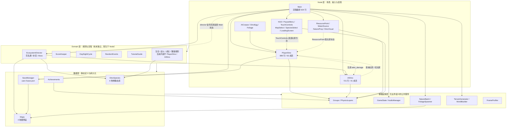

# 架构现状与重构路线

> 适用版本：v0.2.6（`project.godot` `config/version="0.2.6"`）
> 数据来源：2026-10-18 全仓审计结论。规模基线为 37 个 `.gd`、5789 行；`PlayerDino` 899 行 / 63 成员 / 17 个 public 接口，承担 13 类职责；`AIDino` 721 行 / 41 成员 / 10 类职责。
> 本文只描述现状与目标，不代表代码已完成重构。

---

## 一、分层现状

### 1.1 分层图

依赖方向的总体约定：**上层依赖下层，下层不得反向依赖上层**。实线为当前真实依赖；虚线为违反该约定的横向/反向依赖，是后续重构要消除的边。

**读图结论**

1. **Domain 层尚未真正存在**：除 `EcosystemDirector`、`ScoreKeeper`、`DayNightCycle`、`RandomEvents`、`TutorialGuide` 外，生存、战斗、成长、繁殖、拖拽、存档规则全部内嵌在 `PlayerDino` / `AIDino` 两个 Node 中。
2. **Node 层互相直连**：`TouchControls→PlayerDino`、`ResourcePoint→PlayerDino`、`AIDino↔PlayerDino` 都是虚线，说明节点之间靠具体类型与方法调用通信，而不是依赖接口或领域事件。
3. **Main 仍是接线中心**：26 处 `connect`、4 处组查询，既做流程编排，又做信号总线、节点装配、存档触发，是最大的耦合汇聚点。
4. **数据层是静态代码库**：`DinoSpecies` / `Maps` 用 `Dictionary` + `static func` 构建，不是 Godot `Resource`，无法在编辑器里配表或热改。

### 1.2 模块职责表

| 文件 | 职责 | 行数 | 层 |
|---|---|---:|---|
| `scripts/game/Main.gd` | 选图/选种/开局/续关/死亡重开流程，节点装配，信号接线，存档触发，加载进度 | 625 | Node（编排） |
| `scripts/player/PlayerDino.gd` | 输入、移动、相机、体力、饥渴、进食、成长、咬击、技能、拖拽、产蛋、受伤死亡、存档、音效 | 899 | Node（含 Domain） |
| `scripts/ai/AIDino.gd` | 0.25s 决策、游荡/狩猎/觅食/饮水/逃跑、领地、仇恨、战斗、产蛋、偷蛋、生存数值 | 721 | Node（含 Domain） |
| `scripts/ai/AICorpse.gd` | 尸体腐烂、啃食次数、拖拽暂停腐烂 | 68 | Node |
| `scripts/ai/StateController.gd` | 早期状态枚举辅助 | 35 | Node |
| `scripts/world/DinoEgg.gd` | AI 蛋孵化计时、被咬破壳、玩家蛋跨代锚点 | 90 | Node |
| `scripts/world/Foliage.gd` | 可食植物、被吃信号 | 57 | Node |
| `scripts/world/NatureProp.gd` | 自然模型实例化、缩放/偏航 | 52 | Node（表现） |
| `scripts/world/DinoVisual.gd` | 恐龙 GLB 加载、动画切换、体型缩放 | 204 | Node（表现） |
| `scripts/world/ResourcePoint.gd` | 巢穴回血/回体力、矿物盐限时 buff | 116 | Node（世界） |
| `scripts/world/WaterSource.gd` | 水源范围与水面 | 15 | Node（世界） |
| `scripts/ui/HUD.gd` | 血/饿/渴/力条、成长、计分、横幅、死亡屏 | 263 | Node（UI） |
| `scripts/ui/PauseMenu.gd` | 暂停/继续/回菜单/设置/成就入口 | 268 | Node（UI） |
| `scripts/ui/TouchControls.gd` | 虚拟摇杆、动作按钮、视角输入信号桥 | 104 | Node（UI） |
| `scripts/ui/Minimap.gd` | 8Hz 小地图重绘 | 63 | Node（UI） |
| `scripts/ui/LookControl.gd` | 右半屏拖拽视角 | 29 | Node（UI） |
| `scripts/ui/VirtualJoystick.gd` | 摇杆输入归一化 | 61 | Node（UI） |
| `scripts/ui/MapSelect.gd` / `SpeciesSelect.gd` | 选图 / 选种界面 | 45 / 45 | Node（UI） |
| `scripts/ui/LoadingScreen.gd` | 加载遮罩与进度文案 | 39 | Node（UI） |
| `scripts/ui/SettingsPanel.gd` | 音量/灵敏度滑条，实时落盘 | 126 | Node（UI） |
| `scripts/game/EcosystemDirector.gd` | AI 花名册、种群补员、Boss 重生、蛋信号转发 | 194 | Domain（Node 型） |
| `scripts/game/ScoreKeeper.gd` | 存活计时、击杀计数、0.5s 刷分节拍 | 37 | Domain |
| `scripts/game/DayNightCycle.gd` | 120s 昼夜、天空/雾/太阳、风暴 | 91 | Domain |
| `scripts/game/RandomEvents.gd` | 随机事件 IDLE/ACTIVE 状态机、三事件 | 158 | Domain |
| `scripts/game/TutorialGuide.gd` | 四步引导扫描与重连 | 150 | Domain |
| `scripts/data/DinoSpecies.gd` | 6 物种属性、食性、技能、成长阶段静态库 | 134 | 数据 |
| `scripts/data/Maps.gd` | 4 地图地形参数、模型清单、数量上限 | 158 | 数据 |
| `scripts/data/SaveManager.gd` | 存档读取、默认值、版本校验、原子写 | 55 | 数据 |
| `scripts/data/Achievements.gd` | 8 项成就与引导标记持久化（autoload） | 127 | 数据 |
| `scripts/core/Groups.gd` | 组名常量 | 12 | 基础设施 |
| `scripts/core/PhysicsLayers.gd` | 物理层/掩码常量 | 32 | 基础设施 |
| `scripts/core/GameState.gd` | 设置加载校验、原子写（autoload） | 75 | 基础设施 |
| `scripts/core/AudioManager.gd` | SFX/Ambient 总线与音量（autoload） | 53 | 基础设施 |
| `scripts/world/NatureBatch.gd` | 自然物 64m 分块 MultiMesh 合批、模板缓存 | 215 | 基础设施（渲染） |
| `scripts/world/FoliageSpawner.gd` | 植物 MultiMesh 池、被吃重生、丰饶期 | 365 | 基础设施（世界） |
| `scripts/world/TerrainGenerator.gd` | 高度图/噪声地形、顶点色、碰撞、`get_height` | 183 | 基础设施（世界） |
| `scripts/game/WorldBuilder.gd` | 地形/水/自然物/资源点参数化构建、分帧 | 179 | 基础设施（世界） |
| `scripts/core/FrameProfiler.gd` | 帧耗时/FPS 调试浮层 | 146 | 基础设施 |
| `tests/run_tests.gd` | 数据层单测入口（38 个断言调用点，47 条断言） | 165 | 测试 |

> 注：审计规模基线为 37 个 `.gd` / 5789 行（审计快照口径）。上表为模块级行数；`Main` 在后续功能回填后当前实测 638 行，其余与审计值一致。维护时以 HEAD 实测为准。

---

## 二、耦合热点

| 热点 | 数据 | 典型证据 | 风险 |
|---|---:|---|---|
| 组查询 | 34 处 / 9 文件 | `AIDino.gd:563`、`PlayerDino.gd:528`、`Main.gd:546` | 每帧或每决策周期全组线性扫描，节点增删与查询时序耦合 |
| 信号连接 | 58 处 / 11 文件（Main 26） | `Main.gd:359-367`、`Main.gd:393-400` | 连接散落，重开/重建节点时易悬挂或重复连接 |
| 双向依赖 | 7 组 | `AIDino.gd:379-382` ↔ `PlayerDino.gd:528-531`；`Main.gd:97-99` ↔ `EcosystemDirector.gd:6-8` | 任一侧改签名需同步改对侧，无法独立测试 |
| 最强耦合边 | Main↔PlayerDino、AIDino↔PlayerDino、ResourcePoint→PlayerDino、Main↔EcosystemDirector、TouchControls→PlayerDino | `ResourcePoint.gd:82-106` 直接调用 `heal/restore_stamina/apply_buff`；`TouchControls.gd:46` 直接取 `PlayerDino` | 节点类型成为事实接口，替换实现成本高 |

---

## 三、技术债清单（Top 10）

优先级定义：**P0 = 阻塞后续开发或直接产生线上缺陷；P1 = 显著放大改动成本；P2 = 可排期优化**。成本按单人有经验开发者估算。

| # | 债务 | 证据（文件:行号） | 后果 | 目标做法 | 成本 | 优先级 |
|---|---|---|---|---|---|---|
| 1 | `PlayerDino` 上帝类：899 行 / 63 成员 / 17 public，13 类职责 | `PlayerDino.gd:246-385`（输入/移动）、`386-447`（体力/生存）、`470-514`（相机）、`515-691`（战斗/技能/拖拽）、`692-783`（成长/产蛋）、`784-826`（伤害/存档）、`827-899`（工具） | 任一战力/数值改动都要碰同一文件；无法单测；合并冲突高发 | 浅继承 `DinoActor` + 组件 `Health / Vitals / Combat / Growth / Repro`；PlayerDino 只保留输入、相机、动画适配 | 8–12 人日 | P0 |
| 2 | `AIDino` 上帝类：721 行 / 41 成员 / 10 类职责，决策与表现混写 | `AIDino.gd:170-317`（决策/领地）、`318-453`（行为）、`454-519`（数值/繁殖）、`520-561`（伤害）、`562-715`（感知/工具） | AI 行为调参需理解整文件；仇恨/领地/繁殖互相干扰；无法做决策单测 | 拆 `AIDecision`（纯策略）与 `AIView`（节点适配）；感知结果每 0.25s 快照注入 | 6–9 人日 | P0 |
| 3 | 6 个分散状态标志，无单一事实源 | `Main.gd:28`（`skip_select`）、`Main.gd:48`（`is_over`）、`Main.gd:51`（`_game_started`）、`PauseMenu.gd:36/42`（`get_tree().paused`）、`HUD.gd:34`（`_is_dead`）、`PlayerDino.gd:102`（`is_dead`） | “死亡/暂停/菜单/加载”组合态不可枚举，已多次出现输入残留与界面叠加缺陷 | 引入 `GameFlow` 枚举状态机（BOOT/MAP_SELECT/SPECIES_SELECT/LOADING/PLAYING/PAUSED/DEAD/MENU），所有 UI 只读状态 | 4–6 人日 | P0 |
| 4 | 存档双写、键名散落 | `Main.gd:511-517` 写 `species_id/growth_stage/generation/best_*`；`PlayerDino.gd:819-824` 又写 `growth_stage/generation`；`SaveManager.gd:30-33` 补 `map_id`；`SpeciesSelect.gd:16-21` 直接读键 | 两处写入顺序决定最终值；新增字段需改多处；无法保证事务性 | 单一 `SaveRepository`：唯一读写入口、键名常量、快照对象、原子提交 | 3–5 人日 | P0 |
| 5 | 无存档迁移函数，只拒绝更高版本 | `SaveManager.gd:24-25` | 未来加字段只能靠 `_ensure_defaults` 兜底；旧档结构变化会静默丢字段 | `SAVE_VERSION=2` + `migrate_v1_to_v2(d)` 链式迁移；迁移前后单测 | 1–2 人日 | P1 |
| 6 | `_restart_run` 手工清理 11 项运行期节点 | `Main.gd:528-585`（玩家/AI/HUD/触屏/随机事件/尸体/选图/选种/计分/状态/蛋） | 新增一个运行期节点就必须记得加清理，漏一项即跨局泄漏或旧 UI 残留 | 运行期节点统一挂 `RunScope` 容器，重开只 `queue_free` 容器并重建 | 3–4 人日 | P1 |
| 7 | Main 集中 26 处信号接线，节点重建路径重复 | `Main.gd:97-99`、`359-367`、`376`、`385-386`、`393-400`、`410` | `_start_game` 与 `_restart_run` 两条路径各自接线，易漏连/重连；改信号需改 Main | 接线下沉到各 `spawn_*` 工厂，或由组件自行订阅；Main 只保留跨域事件 | 3–5 人日 | P1 |
| 8 | 全局组查询 34 处 / 9 文件，AI 感知周期性全扫 | `AIDino.gd:563-704`（玩家/威胁/猎物/植物/水/兽群）、`PlayerDino.gd:528/599/756/829/887`、`Minimap.gd` 4 处 | 种群规模上升后 O(n²)；查询结果依赖入树时序，空组时静默失效 | 感知快照服务（0.25s 统一采集一次），领域层只消费快照；查询集中到 `WorldQuery` | 5–7 人日 | P1 |
| 9 | 业务规则 0 单测，仅 4 个纯数据类有覆盖 | `tests/run_tests.gd:14-21` 只调用 Groups/PhysicsLayers/Maps/DinoSpecies/SaveManager | 生存/战斗/繁殖改动只能靠真机试玩；历史上数值类缺陷反复出现 | Domain 抽取后按类补单测；先覆盖 `Vitals / Combat / Growth / Repro` 四条主链 | 6–8 人日 | P1 |
| 10 | 物种/地图数据硬编码为静态 `Dictionary`，非 `Resource` | `DinoSpecies.gd:84-117`（`_db` + `SpeciesDef.new`）、`Maps.gd:49-56/72-156`（`_build` + 四个工厂函数） | 调数值必须改代码并重新导出；无法做编辑器配表、模组或 A/B 平衡 | `SpeciesDef.tres` / `MapDef.tres` + `ResourceLoader`；静态 API 保留为薄封装 | 4–6 人日 | P2 |

**已偿还/不计入债务的性能项**：`NatureBatch` 64m 分块 MultiMesh（`NatureBatch.gd:11-14`）、`FoliageSpawner` 植物 MultiMesh 池、`TerrainGenerator` `HeightMapShape3D` 257²、`ResourceLoader` 线程预加载（`Main.gd:291-348`）、`AIDino` 0.25s 决策节流（`AIDino.gd:32`）、物理层常量化、`FrameProfiler`。这些是既有资产，重构时应保留语义。

---

## 四、重构路线图

四个阶段串行推进，每一阶段都必须保持**可运行、可导出 APK**。禁止一次性大爆炸替换。

### 阶段 A：Domain 抽取（P0，约 2 周）

**范围**：`Health / Vitals / Combat / Growth / Repro` 五个纯逻辑类（`RefCounted`），`DinoActor` 浅基类只放共享字段与信号契约。

| 步骤 | 可运行中间态 | 验收条件 |
|---|---|---|
| A1 定义契约 | 新增 `DinoActor`，`PlayerDino`/`AIDino` 继承；字段与信号保持原签名 | headless 16s 0 脚本错误；现有 47 条单测全过 |
| A2 抽 `Vitals` | 饥/渴/体力累加器从 `PlayerDino.gd:127-132`、`386-447` 移入 `Vitals`；节点每帧调用 `vitals.tick(delta)` | 同一物种同一进食序列下，数值与旧版误差 ≤1 点；HUD 信号频率不变 |
| A3 抽 `Combat` | 咬击、冲锋、受击、减伤、仇恨窗口移入 `Combat`；`take_damage` 签名保持 | 玩家咬 AI、AI 咬玩家、AI 互咬三类路径冒烟通过 |
| A4 抽 `Growth` / `Repro` | 成长阶段、进食计数、产蛋条件与冷却移入纯类；节点只做动画与挂树 | 成长 0→4、产蛋、跨代重生三条手工用例通过 |
| A5 收口 | `PlayerDino` ≤600 行、`AIDino` ≤500 行；Domain 类单测 ≥25 条 | 单测 `PASSED` 总数 ≥72；真机一局 10 分钟无脚本错误 |

**中间态定义**：节点仍是唯一驱动者，Domain 类不持有 Node 引用（只接收数值与查询结果）；所有旧 public 方法保留为转发，外部调用方零改动。

### 阶段 B：存档统一（P0，约 1 周）

| 步骤 | 可运行中间态 | 验收条件 |
|---|---|---|
| B1 建 `SaveRepository` | 唯一读写 `user://save.json`；`SaveManager` 退化为兼容门面 | 全仓检索 `user://` 仅命中 `SaveRepository` 与测试 |
| B2 键名常量 + 快照 | `SaveKeys` 常量表；`SaveData` 快照对象；Main/PlayerDino 只提交快照 | 键名裸字符串 0 处；死亡/续关/回菜单三路径存档一致 |
| B3 迁移链 | `SAVE_VERSION=2`，`migrate_v1_to_v2`；旧档自动升级 | v1 样本档迁移后字段完整；未来版本仍安全回退 |
| B4 双写拆除 | 删除 `PlayerDino._save_progress` 与 Main 的直接写盘 | 存档只在一处发生；单测覆盖损坏档/缺字段/未来档 |

### 阶段 C：数据资源化（P2，约 3–4 天）

| 步骤 | 可运行中间态 | 验收条件 |
|---|---|---|
| C1 `SpeciesDef.tres` | 6 个物种各一个 `.tres`；`DinoSpecies.by_id` 内部走 `ResourceLoader` | 单测校验 6 个资源字段完整、成长阶段 5 段 |
| C2 `MapDef.tres` | 4 张地图资源化；`Maps.all()` 从目录加载 | 单测校验 4 图数量上限、模型体积约束 |
| C3 兼容层 | 旧静态 API 保留，签名不变 | 全量 headless 16s 0 错误；开局加载耗时 ≤ 旧版 +10% |

### 阶段 D：GameFlow 与组件化（P1，约 1–2 周）

| 步骤 | 可运行中间态 | 验收条件 |
|---|---|---|
| D1 状态机 | `GameFlow` 枚举 + `transition(to)`；`skip_select/is_over/_game_started/_is_dead` 收敛为只读查询 | 状态迁移表全覆盖单测；无布尔标志残留 |
| D2 运行域容器 | 运行期节点统一挂 `RunScope`；`_restart_run` 只重建容器 | 重开 20 次后节点数稳定；无悬挂连接警告 |
| D3 事件收敛 | 只保留 3–5 个 typed 跨域事件（玩家死亡、AI 死亡、蛋孵化、事件开始/结束） | Main `connect` 数量从 26 降到 ≤12 |
| D4 收口 | Main ≤300 行；autoload 保持 3 个（上限 4） | 全链路冒烟：选图→选种→开局→暂停→死亡→重开→回菜单 0 脚本错误 |

**总体验收口径**：每阶段结束必须同时满足——导入 0 `SCRIPT ERROR`、单测全过、headless 16s 冒烟 0 脚本错误、APK 可导出且签名校验通过、`docs/PROGRESS.md` 与 `docs/QA.md` 已更新。

---

## 五、明确不做什么

| 不做 | 原因 | 替代方案 |
|---|---|---|
| **不上 ECS** | 当前实体规模（玩家 1 + AI 十余 + 尸体/蛋/植物）远未到 ECS 收益点；迁移会重写全部节点逻辑，风险大于收益 | 浅继承 + 组件组合，保留 Godot 节点树与物理 |
| **不引入 DI 框架** | 单场景、单进程、无多租户；引入容器只会增加启动时序与调试成本 | 构造函数/`setup()` 显式注入；依赖方向由分层约束保证 |
| **不做万能 EventBus** | 全局事件总线会把“谁依赖谁”变得不可见，重复当前信号散落的问题 | 只保留 3–5 个 typed 跨域事件；域内用直接方法或局部信号 |
| **不做 6 物种 6 子类** | 物种差异是数据差异（体型/食性/技能/成长倍率），不是行为多态；子类化会导致 6 份重复逻辑 | 单一 `DinoActor` + `SpeciesDef` 数据驱动；确有独特行为时用组件开关 |
| **不扩 autoload** | 全局单例越多，测试隔离越差，启动顺序越脆弱 | autoload 上限 4 个；当前 3 个（GameState/AudioManager/Achievements） |

---

## 六、维护约定

1. 结构性改动（拆类、换数据形态、改状态机）必须同步更新本文第一、三、四节。
2. 新增技术债先登记到第三节，再排期；禁止口头债务。
3. 每阶段完成后在 `docs/PROGRESS.md` 写清“改动—验证数字—遗留”，并在 `docs/QA.md` 更新覆盖矩阵。
4. 行号引用以当前 HEAD 为准；文件大改后需校正证据行号。
